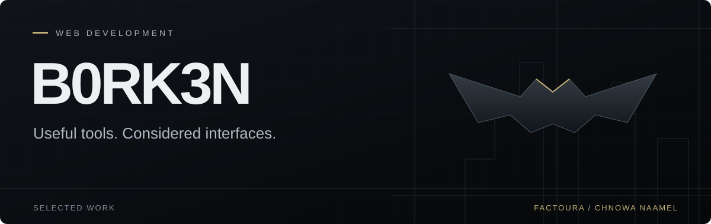
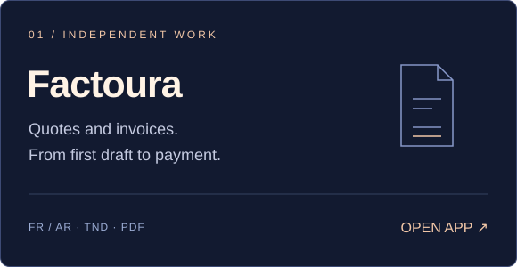
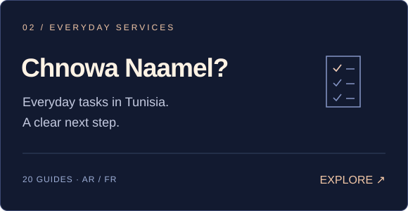

 

I build web tools that make everyday work simpler. My focus is on clear interfaces, careful details, and learning through projects people can actually use.

### Selected work

**[Factoura ↗](https://factoura-freelance.blond-jay-1497.chatgpt.site/)** — Create quotes and invoices in French or Arabic, calculate TND totals, track payments, and print to PDF. Documents stay in your browser, with JSON backups for moving between devices. [Repository](https://github.com/B0RK3N/factoura).

**[Chnowa Naamel? ↗](https://chnowa-naamel.blond-jay-1497.chatgpt.site/#guides)** — 40 practical guides to everyday services in Tunisia, with official source links, multilingual search, saved checklists, progress filters, and shareable guides in Tunisian Arabic and French. [Repository](https://github.com/B0RK3N/chnowa-naamel).

**[B0RK3N Link ↗](https://github.com/B0RK3N/B0RK3N/tree/main/projects/b0rk3n-link)** — Windows toolkit for private access to a desktop AI agent, Remote Desktop, and file transfer from a laptop. Includes setup, connection checks, startup, and recovery scripts. Desktop AI access and startup are configured and verified; laptop pairing remains.

### Working with

`HTML` &nbsp; `CSS` &nbsp; `JavaScript` &nbsp; `Git`

Responsive layouts, multilingual interfaces, and browser-based tools. I use AI assistance while building, then work through the code and test the user flows.

 

Independent projects, built and improved one release at a time.
